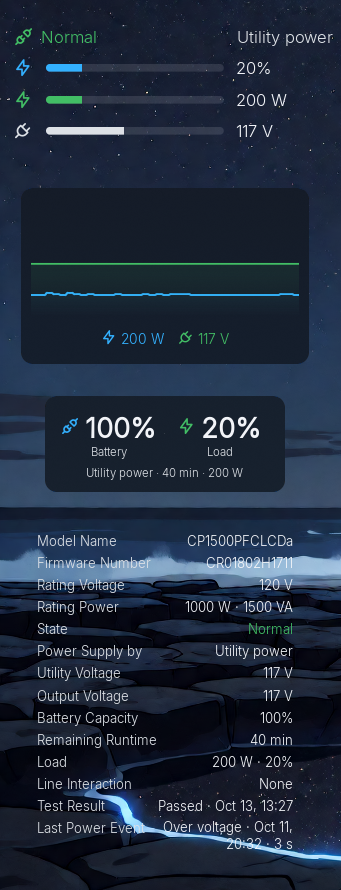
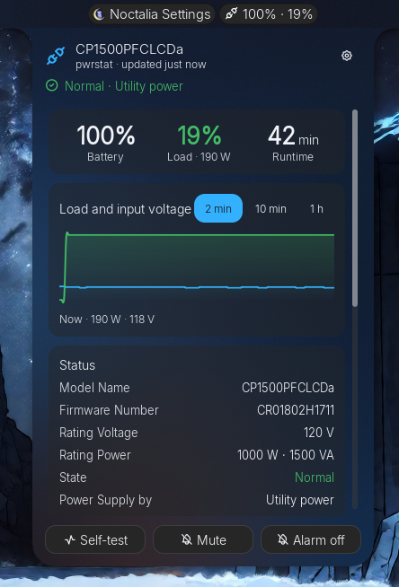
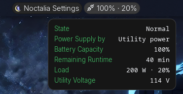

# CuteMonitor

Home of **CuteMonitor — UPS Status** (`cutecaption/cutemonitor-ups`), a Noctalia 5 plugin
that shows UPS status from CyberPower's `pwrstat` or from NUT. The plugin lives in
[`cutemonitor-ups/`](cutemonitor-ups/README.md); that folder alone is what goes to the
Noctalia community plugin store.

## Screenshots

The four desktop layouts (Gauges, Graph, Status, Readout), the detail panel, and the bar
item's tooltip:

<p>
  
  
</p>
<p>
  
</p>

## Using it from this folder

This folder is a Noctalia plugin source. Register it once (with the path you cloned it
to), then enable the plugin:

```sh
noctalia msg plugins source add cutecaption path ~/Projects/cutemonitor
```

```sh
noctalia msg plugins enable cutecaption/cutemonitor-ups
```

Edits to `.luau` files reload live. Noctalia reads `plugin.toml` again only when its plugin
configuration changes or it restarts, so after editing the manifest, disable and re-enable
the plugin (or restart Noctalia). To remove it again:

```sh
noctalia msg plugins disable cutecaption/cutemonitor-ups
```

```sh
noctalia msg plugins source remove cutecaption
```

## Checks

Run these from this folder. `luau-analyze` picks up `.luaurc` here, which declares
Noctalia's globals, so it must be started from this folder.

```sh
luau-analyze cutemonitor-ups/*.luau cutemonitor-ups/tests/*.luau
```

```sh
noctalia plugins lint cutemonitor-ups
```

Unit tests (`luau` from the `luau` package):

```sh
luau cutemonitor-ups/tests/pwrstat_test.luau
```

```sh
luau cutemonitor-ups/tests/nut_test.luau
```

```sh
luau cutemonitor-ups/tests/shared_test.luau
```

```sh
luau cutemonitor-ups/tests/tracker_test.luau
```

The pure modules (`source_pwrstat`, `source_nut`, `tracker`, and the formatting half of
`shared`) are covered by these tests, with real `pwrstat` captures, NUT device-library dumps
and synthesized outage states as fixtures.

The entry scripts (service, desktop widget, bar item, panel) run offline in the harness,
against a fake Noctalia that follows 5.2.1's own rules (see
[`tools/harness/`](tools/harness/README.md)):

```sh
bash tools/harness/run-ups.sh
```

Inside Noctalia, preview outage states with the `simulate` command in the plugin's README.

## Design

[`DESIGN.md`](DESIGN.md) records the CuteMonitor design language — layout, type, color,
states, settings names, architecture and platform facts — for this and future tools.
